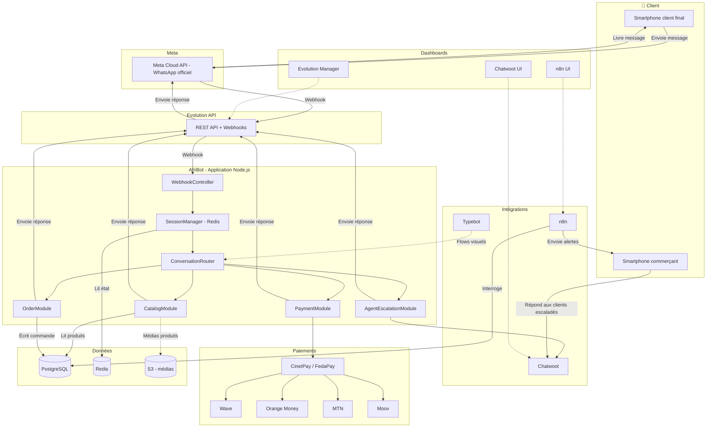
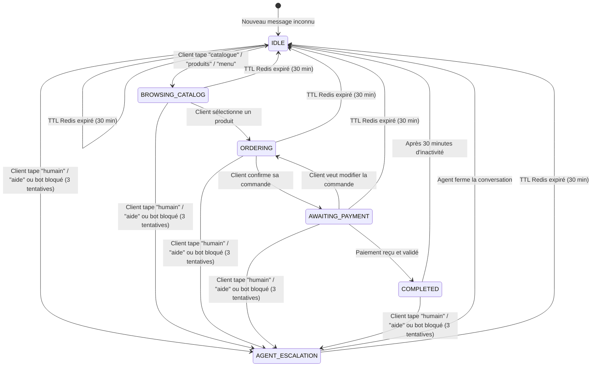
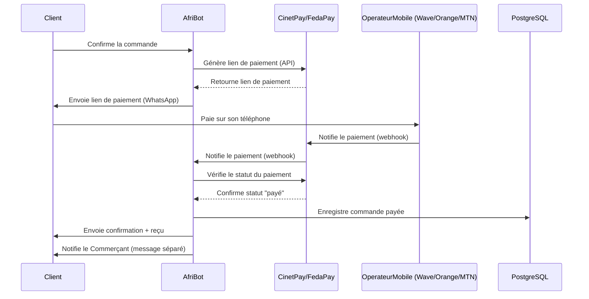

# Architecture technique — AfriBot

Ce document est la référence technique du projet AfriBot. Il décrit l'ensemble des composants, les flux de données et les décisions d'architecture. Toute IA ou développeur rejoignant le projet doit lire ce fichier avant de contribuer au code.

## 1. Vue d'ensemble

AfriBot est une couche applicative construite au-dessus d'Evolution API. Tout message WhatsApp transite exclusivement par la Meta Cloud API officielle, garantissant l'absence de risque de bannissement. Chaque conversation possède une machine à états stockée dans Redis, permettant de savoir à tout instant où en est l'échange avec le client. Les commandes validées sont persistées durablement dans PostgreSQL via Prisma ORM. Les paiements Mobile Money transitent par une API unifiée (CinetPay ou FedaPay) qui abstrait les opérateurs Wave, Orange Money, MTN et Moov. Lorsque le bot ne peut pas répondre, Chatwoot prend le relais pour escalader la conversation vers un agent humain. n8n orchestre en parallèle les automatisations transverses : alertes commerçant, rapports périodiques et relances clients. L'ensemble des services est conteneurisé via Docker Compose et exposé derrière un reverse proxy Nginx en SSL.

## 2. Diagramme UML — Architecture système complète

## 3. Diagramme — Machine à états d'une conversation

## 4. Diagramme — Flux de paiement Mobile Money

## 5. Description des modules

| Module | Fichier | Responsabilité | Dépendances | État |
|---|---|---|---|---|
| WebhookController | `src/shared/webhook.controller.ts` | Réceptionne les webhooks entrants depuis Evolution API et déclenche le traitement du message | Evolution API | Fait |
| SessionManager | `src/shared/session.ts` | Lit et écrit l'état de conversation (état courant, contexte, TTL) dans Redis | Redis | Fait |
| ConversationRouter | `src/shared/conversation.router.ts` | Route le message vers le module métier adapté selon l'état de la conversation | SessionManager | Fait |
| CatalogModule | `src/modules/catalog/catalog.module.ts` | Répond aux demandes de catalogue : prix, stock, photos produits | PostgreSQL, S3 | Fait |
| OrderModule | `src/modules/orders/order.module.ts` | Gère la prise de commande conversationnelle et sa persistance | PostgreSQL | Fait |
| PaymentModule | `src/modules/payments/payment.module.ts` | Génère les liens de paiement et traite les webhooks de confirmation | CinetPay/FedaPay, PostgreSQL | Fait |
| AgentEscalationModule | `src/modules/agents/agent.module.ts` | Transfère la conversation vers un agent humain via Chatwoot | Chatwoot | Fait |
| DashboardModule | `src/modules/dashboard/stats.service.ts` | Expose les statistiques et l'historique des commandes au commerçant | PostgreSQL | Fait |
| WorkflowOrchestrator | `docker/n8n/` | Orchestre les alertes, rapports et relances automatisées | PostgreSQL, n8n | Fait |

## 6. Décisions techniques importantes

### ADR-001 : Pourquoi Cloud API Meta et pas Baileys
Baileys est une librairie non officielle qui simule un client WhatsApp Web. Son usage expose les commerçants à un bannissement définitif du numéro, sans recours possible auprès de Meta. La Cloud API Meta est la voie officielle, contractuelle et stable, indispensable pour un usage commercial pérenne.

### ADR-002 : Pourquoi Evolution API et pas une intégration directe Meta
Evolution API fournit une couche d'abstraction REST et webhooks au-dessus de la Cloud API Meta, simplifiant la gestion des instances, des médias et des templates de messages. Elle évite de réimplémenter la gestion bas niveau du protocole Meta et accélère le développement des fonctionnalités métier.

### ADR-003 : Pourquoi Redis pour les sessions
Les conversations WhatsApp nécessitent un accès en lecture/écriture très rapide à l'état courant, avec une expiration automatique (TTL). Redis répond nativement à ces deux besoins et supporte la charge de nombreuses conversations simultanées sans solliciter la base relationnelle.

### ADR-004 : Pourquoi CinetPay/FedaPay et pas une intégration directe Wave
CinetPay et FedaPay proposent une API unifiée couvrant plusieurs opérateurs Mobile Money (Wave, Orange Money, MTN, Moov) sur plusieurs pays africains. Une intégration directe par opérateur multiplierait les contrats, les certifications et la maintenance technique, sans bénéfice pour le commerçant final.

### ADR-005 : Pourquoi Typebot pour les flows et pas du code custom
Typebot permet aux commerçants et administrateurs de concevoir et modifier des parcours conversationnels visuellement, sans intervention d'un développeur. Cela réduit le temps de mise à jour des scénarios métier et découple la logique conversationnelle simple du code applicatif.

### ADR-006 : Optimisation messages Afrique (légèreté, 2G/3G)
Les connexions mobiles en Afrique sont souvent limitées en bande passante (2G/3G). AfriBot privilégie les messages texte courts, compresse les images de catalogue et limite les échanges multimédias non essentiels, afin de garantir une expérience fluide même sur des réseaux lents.
